# Keycloak con autenticación externa (Google) y aplicación dummy en Python

Entorno local de **Keycloak 26.8.2** en Docker, con un realm propio, inicio de sesión federado con **Google** y una aplicación web en **Python (Flask)** que, una vez autenticado el usuario, muestra `Hola Mundo, <usuario>`.

**Resultados:** Keycloak queda corriendo en local con Docker y sus datos persisten en un volumen mapeado, de modo que la configuración sobrevive a reinicios y recreaciones del contenedor. El realm `semillero` centraliza la identidad de la aplicación: define los roles `usuario` y `admin`, asigna `usuario` automáticamente a toda cuenta nueva y registra la aplicación como cliente confidencial con flujo Authorization Code y PKCE. Google funciona como proveedor de identidad externo, así que cualquier cuenta de Google autorizada puede entrar sin crear una contraseña nueva, y Keycloak crea y vincula el usuario en el realm en su primer inicio de sesión. La aplicación dummy delega por completo la autenticación en Keycloak, nunca maneja contraseñas ni habla directamente con Google, y muestra `Hola Mundo, <usuario>` con el nombre y los roles que recibe en el ID token. Los secretos se mantienen fuera del repositorio mediante variables de entorno.

---

## ✅ Resultados

### Inicio de sesión con Google

El usuario entra con su cuenta de Google a través de Keycloak y la aplicación lo saluda por su nombre.

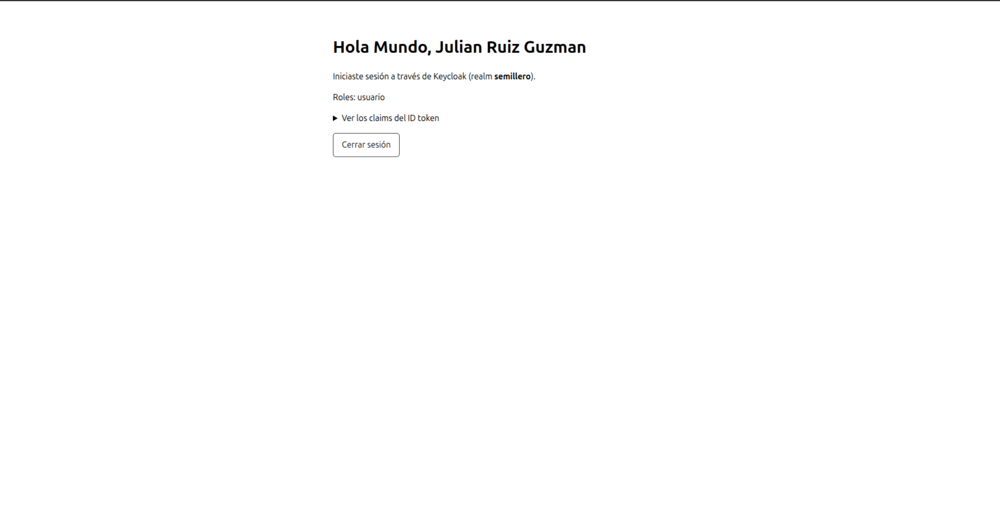

### Inicio de sesión con usuario local del realm

El mismo flujo con un usuario creado directamente en Keycloak, que además tiene el rol `admin`.

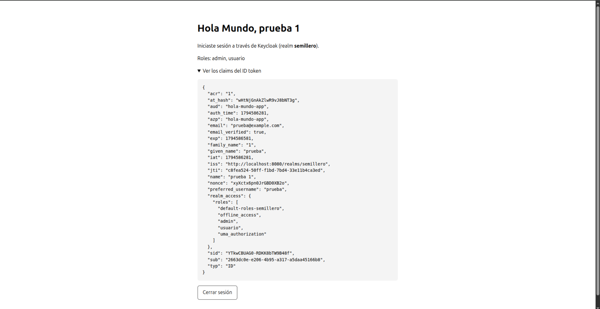

### Página inicial de la aplicación

Sin sesión, la aplicación ofrece dos formas de entrar: **Iniciar sesión con Keycloak**, que muestra el login del realm con usuario y contraseña o el botón de Google, y **Entrar directo con Google**, que envía `kc_idp_hint=google` para saltar la pantalla de Keycloak.

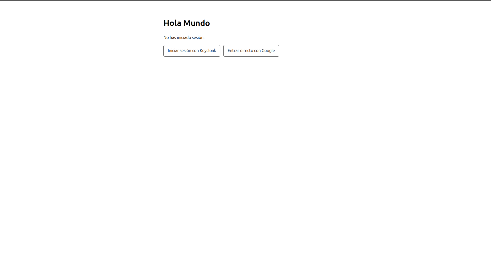

### Información que Keycloak entrega a la aplicación (claims del ID token)

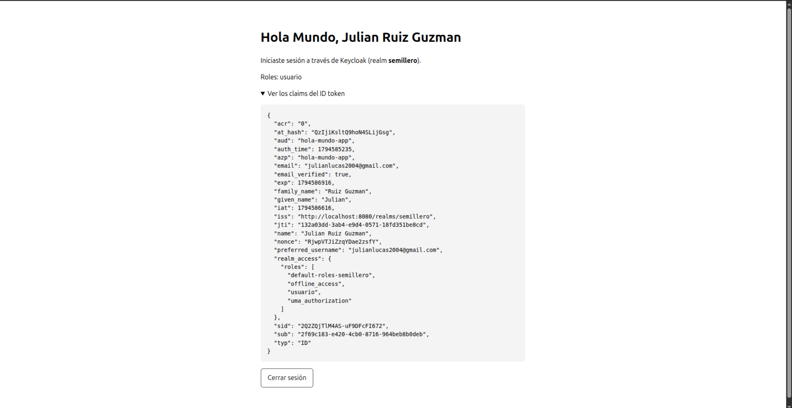

### Alcance esperado del ejercicio

| Requisito | Estado | Evidencia |
|---|---|---|
| Keycloak corriendo en local con Docker | ✅ | [docker-compose.yml](docker-compose.yml), imagen 05 |
| Volúmenes mapeados para persistir datos | ✅ | `./keycloak_data:/opt/keycloak/data`, imagen 06 |
| Realm distinto de `master` | ✅ | Realm `semillero`, imagen 07 |
| Cliente y roles básicos | ✅ | Cliente `hola-mundo-app`, roles `usuario` y `admin`, imágenes 08 a 10 |
| Aplicación registrada en Google Cloud Console | ✅ | Imagen 13 |
| Google configurado como Identity Provider | ✅ | Imagen 11 |
| Autenticación probada con cuentas de Google | ✅ | Imágenes 01, 04 y 12 |
| Aplicación dummy con login vía Keycloak | ✅ | [app/app.py](app/app.py), imágenes 01 a 03 |
| Mensaje `Hola Mundo, <usuario>` tras autenticarse | ✅ | Imágenes 01 y 02 |
| Flujo Authorization Code | ✅ | Con PKCE (S256), imagen 14 |

---

## Arquitectura

```text
Navegador ──(1) "Iniciar sesión"──▶ App Flask (localhost:5000)
    │◀──────(2) redirección a Keycloak──┘
    ▼
Keycloak (localhost:8080, realm "semillero")
    │──(3) "Google"──▶ Google OAuth ──(4) identidad del usuario──▶ Keycloak
    │
    └──(5) redirección a /callback?code=...──▶ App Flask
                                                 │ (6) code → tokens (servidor a servidor)
                                                 ▼
                                       "Hola Mundo, <usuario>"
```

- La aplicación **solo confía en Keycloak**. Nunca habla con Google.
- Keycloak actúa como **broker de identidad**: Google autentica al usuario y Keycloak le emite sus propios tokens.
- Los usuarios que entran con Google se crean en el realm la primera vez y reciben automáticamente el rol `usuario`.

---

## Estructura del repositorio

| Ruta | Contenido |
|---|---|
| `docker-compose.yml` | Keycloak en modo `start-dev` con volumen persistente |
| `.env.example` | Plantilla de variables de entorno, sin valores reales |
| `.gitignore` | Excluye secretos, datos de Keycloak y entorno virtual |
| `app/app.py` | Aplicación Flask con OpenID Connect (Authlib) |
| `app/requirements.txt` | Dependencias de Python |
| `realm/semillero-realm.json` | Export parcial del realm (secretos enmascarados) |
| `docs/Imagenes_Pruebas/` | Capturas de evidencia |

---

## Cómo ejecutarlo

**Requisitos:** Ubuntu (o cualquier Linux con Docker), Docker Engine con el plugin Compose, Python 3.10 o superior y una cuenta de Google.

```bash
# 1. Configuración
cp .env.example .env
chmod 600 .env
# Editar .env: KC_ADMIN_PASSWORD, APP_SECRET_KEY y OIDC_CLIENT_SECRET

# 2. Keycloak
mkdir -p keycloak_data
sudo chown 1000:1000 keycloak_data
sudo docker compose up -d
# Consola de administración: http://localhost:8080

# 3. Configurar realm, cliente y Google (ver "Explicación detallada")

# 4. Aplicación
python3 -m venv .venv
source .venv/bin/activate
pip install -r app/requirements.txt
python app/app.py
# Aplicación: http://localhost:5000
```

### Variables de entorno

| Variable | Uso |
|---|---|
| `KEYCLOAK_VERSION` | Versión fija de la imagen de Keycloak |
| `KEYCLOAK_PORT` | Puerto local de Keycloak |
| `KC_ADMIN_USER` / `KC_ADMIN_PASSWORD` | Administrador inicial, creado solo en el primer arranque |
| `KEYCLOAK_URL` | URL de Keycloak vista desde el navegador |
| `KEYCLOAK_REALM` | Realm que usa la aplicación |
| `OIDC_CLIENT_ID` / `OIDC_CLIENT_SECRET` | Credenciales del cliente `hola-mundo-app` en Keycloak |
| `APP_BASE_URL` | URL pública de la aplicación, usada para construir la callback |
| `APP_HOST` / `APP_PORT` | Interfaz y puerto donde escucha Flask |
| `APP_SECRET_KEY` | Clave que firma la cookie de sesión |
| `LOG_LEVEL` | Nivel de logs |

---

## Explicación detallada

### 1. Keycloak con Docker y volumen persistente

[docker-compose.yml](docker-compose.yml) levanta la imagen oficial `quay.io/keycloak/keycloak` con versión fija.

- **`command: start-dev`**: modo desarrollo, con HTTP y base de datos interna H2.
- **`environment`**: el usuario administrador se toma del `.env`, así que la contraseña no queda en el repositorio.
- **`ports: 127.0.0.1:8080:8080`**: Keycloak solo es accesible desde el propio equipo. En Linux, Docker publica puertos saltándose el firewall `ufw`; atar el puerto a `127.0.0.1` evita exponerlo a la red.
- **`volumes: ./keycloak_data:/opt/keycloak/data`**: la base de datos de Keycloak vive en una carpeta del host. Al eliminar y recrear el contenedor (`docker compose down` / `up`), el realm, los usuarios y los clientes se conservan.

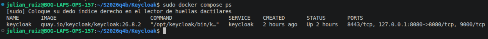

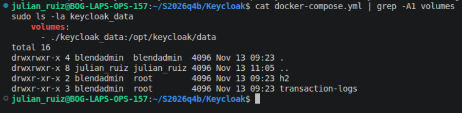

### 2. Realm `semillero`

Un realm es un espacio aislado con sus propios usuarios, roles y aplicaciones. `master` se reserva para administrar Keycloak, por lo que se creó el realm `semillero`.

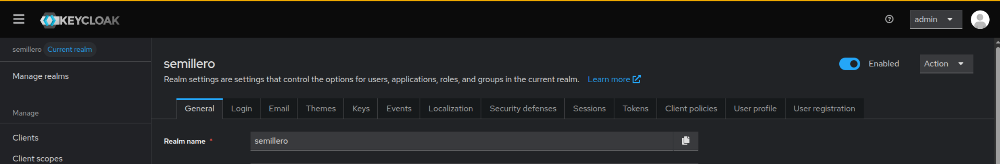

### 3. Roles

| Rol | Uso |
|---|---|
| `usuario` | Rol por defecto: lo recibe todo usuario nuevo, incluidos los que llegan desde Google |
| `admin` | Asignado manualmente al usuario local de prueba |

El rol `usuario` se agregó a **Realm settings → User registration → Default roles**. Para que la aplicación pueda leer los roles, se activó **Add to ID token** y **Add to userinfo** en el mapper `realm roles` del client scope `roles`.

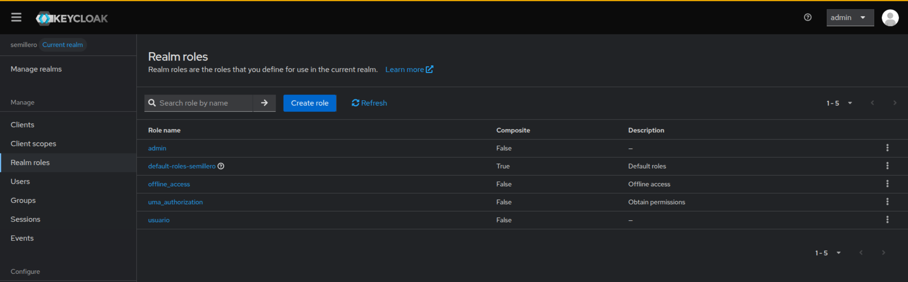

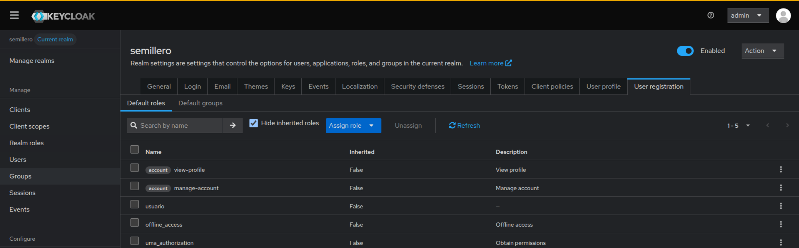

### 4. Cliente `hola-mundo-app`

Es el registro de la aplicación dentro de Keycloak.

| Configuración | Valor | Motivo |
|---|---|---|
| Client authentication | ON | Cliente confidencial: la app corre en servidor y puede guardar un secreto |
| Standard flow | ON | Flujo Authorization Code |
| Direct access grants | OFF | Evita que la aplicación reciba contraseñas de usuarios |
| PKCE | S256 | Impide canjear un código interceptado |
| Valid redirect URIs | `http://localhost:5000/callback` | URI exacta, sin comodines |
| Valid post logout redirect URIs | `http://localhost:5000/` | Retorno tras cerrar sesión |
| Web origins | `http://localhost:5000` | Origen permitido |

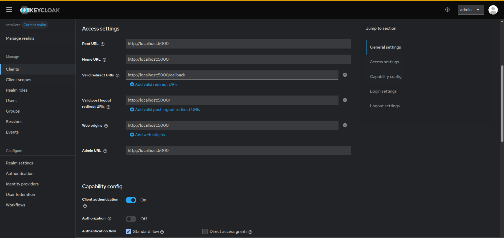

### 5. Google como Identity Provider

**En Google Cloud Console:**

1. Proyecto `keycloak-semillero` y pantalla de consentimiento OAuth de tipo **External**, en modo *Testing*.
2. Cuentas de prueba agregadas en **Test users**.
3. Cliente OAuth `keycloak-local` de tipo **Aplicación web**, con la redirect URI del broker de Keycloak:
   `http://localhost:8080/realms/semillero/broker/google/endpoint`

En **APIs y servicios → Credenciales** aparece el cliente `keycloak-local` creado dentro del proyecto:

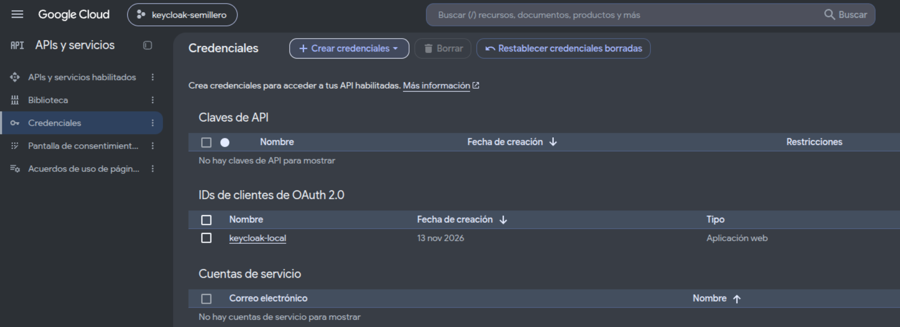

**En Keycloak:** **Identity providers → Google**, con el Client ID y el Client Secret de Google. La Redirect URI que muestra Keycloak debe coincidir carácter por carácter con la registrada en Google. El proveedor queda registrado en el realm con el alias `google`:

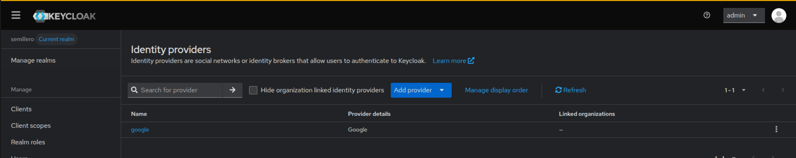

En el primer inicio de sesión, Keycloak crea el usuario en el realm con los datos que entrega Google (correo, nombre y apellido) y lo vincula con esa cuenta. La lista de usuarios muestra dos cuentas creadas así, junto al usuario local `prueba`:

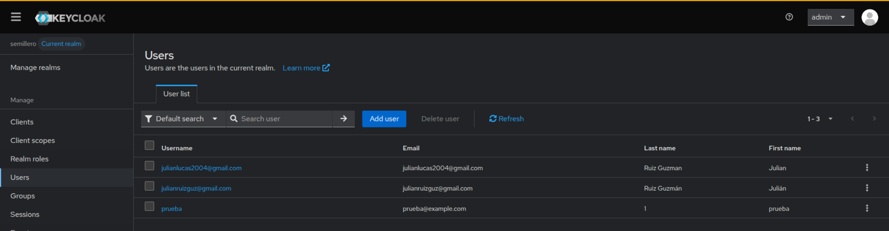

### 6. Aplicación dummy en Python

[app/app.py](app/app.py) usa **Flask** como servidor web y **Authlib** como cliente OpenID Connect.

| Ruta | Función |
|---|---|
| `/` | Muestra `Hola Mundo, <usuario>` si hay sesión, o los botones de login |
| `/login` | Redirige a Keycloak. Con `?idp=google` envía `kc_idp_hint=google` y salta directo a Google |
| `/callback` | Recibe el `code`, lo canjea por tokens y valida el ID token |
| `/logout` | Borra la sesión local y cierra también la sesión en Keycloak |
| `/healthz` | Comprobación de estado |

Authlib obtiene los endpoints de Keycloak desde el documento de descubrimiento (`/.well-known/openid-configuration`) y en el callback valida `state`, `nonce`, firma, emisor, audiencia y expiración del ID token.

### 7. Flujo Authorization Code con PKCE

1. El usuario pulsa **Iniciar sesión**. La app genera `state`, `nonce` y un reto PKCE, los guarda en su sesión y redirige a `/protocol/openid-connect/auth`.
2. Keycloak muestra su login. Si el usuario elige Google, Keycloak lo redirige allí y recibe la identidad de vuelta.
3. Keycloak redirige a `http://localhost:5000/callback?code=...&state=...`.
4. La app comprueba el `state` y canjea el `code` en el endpoint de tokens, en una llamada servidor a servidor que incluye el `client_secret` y el `code_verifier`.
5. Keycloak responde con el ID token y el access token. La app lee el nombre del usuario y muestra el saludo.

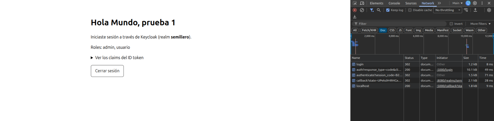

### 8. Export del realm

[realm/semillero-realm.json](realm/semillero-realm.json) contiene un export parcial del realm, con roles y clientes. Keycloak enmascara los secretos con `**********` y el export no incluye usuarios.

---

## Seguridad

| Elemento | Manejo |
|---|---|
| `.env` | Contiene los valores reales, tiene permisos `600` y está en `.gitignore` |
| `.env.example` | Solo documenta las variables, sin valores reales |
| Client Secret de Google | Vive únicamente dentro de Keycloak |
| `keycloak_data/` | Base de datos de Keycloak, excluida del repositorio |
| Puertos | Keycloak y la app escuchan solo en `127.0.0.1` |
| Cookie de sesión | Firmada, `HttpOnly` y `SameSite=Lax` |
| Modo debug de Flask | Desactivado |

`start-dev` y el servidor de desarrollo de Flask son válidos solo para pruebas locales.

---

## Problemas encontrados y solución

| Problema | Causa | Solución |
|---|---|---|
| `permission denied ... /var/run/docker.sock` | El usuario no pertenece al grupo `docker` | Ejecutar los comandos de Docker con `sudo` |
| Keycloak sin permisos sobre `/opt/keycloak/data` | La carpeta del volumen pertenecía a otro UID | `sudo chown 1000:1000 keycloak_data`, el UID con el que corre Keycloak en el contenedor |
| `mismatching_state: CSRF Warning! State not equal in request and response` | La cookie de sesión de la app no llegó al callback (cookies previas o mezcla de `localhost` y `127.0.0.1`) | Usar siempre `localhost` y probar en una ventana de incógnito |
| `ERR_CONNECTION_REFUSED` en el navegador | La app o el contenedor estaban detenidos | Verificar con `sudo docker compose ps` y relanzar `python app/app.py` |
| `redirect_uri_mismatch` en Google | La redirect URI de Google no coincidía con la del broker de Keycloak | Copiar exactamente la Redirect URI que muestra Keycloak en el Identity Provider |
